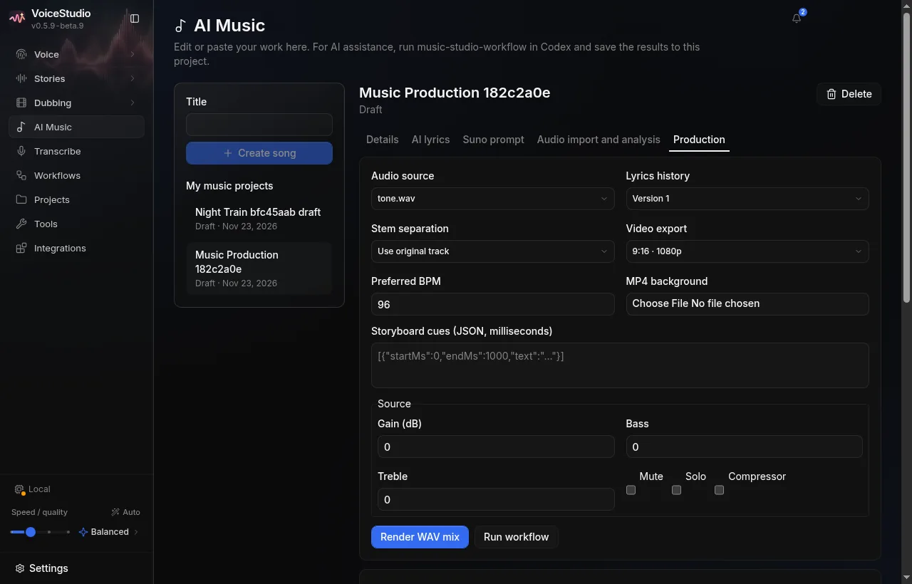

# Music M2–M4 verification

The Linux Electron smoke uses the real backend and a two-second local 48 kHz test tone. It starts a production run from the workspace, verifies WAV, waveform and JSON outputs, loads the MP4 through the Electron media transport, checks 1080 × 1920 video metadata, and relaunches the app to reopen those outputs. See the [saved analysis and artifact hashes](evidence/production-report.json).



The backend suite renders both 1080 × 1920 and 1920 × 1080 with real FFmpeg. It checks AAC output, manual MP4 intake, Mandarin character highlighting, byte-range reads, input validation, missing weights, and retry after cancellation using the completed mix. The optional AI provider contract is tested with a local fixture. No provider account or subscription is needed for the smoke.

Commands from the repository root:

```bash
uv run --no-sync pytest tests/music tests/test_karaoke_ass.py tests/test_mobile_contract.py tests/test_locale_parity.py tests/test_no_hardcoded_cjk.py tests/test_changelog_fragments.py -q
bun run --cwd electron typecheck
bun run --cwd electron build
node --test electron/tests/music-production-smoke.mjs electron/tests/music-workstation-smoke.mjs
```

Use the isolated backend and fixture environment described in [Music M1 verification](VERIFICATION.md). Production tests require FFmpeg and FFprobe. Set `HF_HUB_OFFLINE=1` and use an empty Hugging Face cache for Python validation.

The trained HTDemucs checkpoint was absent here. `tests/music/test_music_separation.py` runs the real Demucs CLI end to end against a tiny randomly initialized HTDemucs in the same package format: it covers repository mode, two- and four-stem file names, the GPU-to-CPU retry and logged diagnostics, but not separation quality. Actual two- and four-stem output quality, timing, and resource usage with installed weights are separate acceptance items. Validate the Windows and macOS native path, including Unicode file paths, playback and export, before merge or release. AI provider integration needs an explicitly configured executable and real service credentials for end-to-end service validation.
