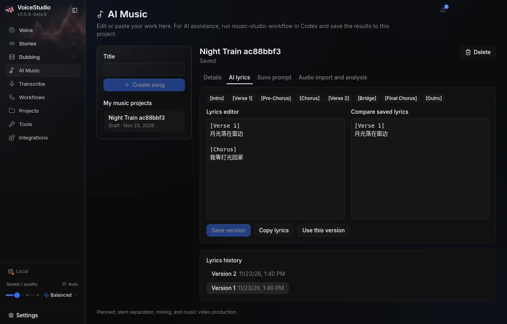
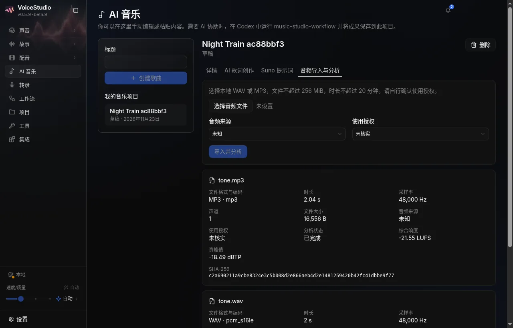

# Music P1 verification

## Linux desktop

The Electron 44.3.0 smoke test ran the built shell against the real FastAPI backend and a temporary SQLite data directory. It entered from the sidebar, created and renamed a song, edited its brief, used the tab keyboard controls, saved two Mandarin lyric versions and compared them, retained an unsaved draft across route changes, saved and copied a Suno prompt, and imported two real files. It closed and relaunched Electron, then reopened the song and checked saved lyrics, prompts and imports. The smoke also switched to Simplified Chinese and checked a narrow viewport for horizontal overflow. No model checkpoint or Suno account was required. Suno's link target was checked without sending a generation request.





## Measured fixtures

FFmpeg 7.1.5 and FFprobe analyzed a synthetic 1 kHz, mono, 48 kHz test tone. The [backend analysis JSON](evidence/audio-report.json) includes file sizes and hashes. The decoded MP3 duration includes MP3 framing/padding. Recreate the fixtures in a scratch folder using the existing FFmpeg and an encoder build with libmp3lame:

```bash
ffmpeg -v error -f lavfi -i 'sine=frequency=1000:sample_rate=48000:duration=2' -c:a pcm_s16le tone.wav
ffmpeg -v error -i tone.wav -c:a libmp3lame tone.mp3
```

| Format | Duration | Integrated loudness | True peak |
| --- | ---: | ---: | ---: |
| WAV / PCM signed 16-bit | 2.00 s | −21.05 LUFS | −18.06 dBTP |
| MP3 | 2.04 s | −21.55 LUFS | −18.49 dBTP |

## Commands and gates

- `uv run --no-sync pytest tests/music -q` ran six tests against the actual FastAPI router and SQLite. It covered migration from 0019, immutable versions and retries, reopening, unauthorized access, traversal, streamed byte limits, duplicate imports, valid WAV/MP3, silence, retained originals, and retries after a forced database write failure.
- `uv run --no-sync pytest tests/music tests/test_mobile_contract.py tests/test_list_sort_indexes_migration.py tests/test_locale_parity.py tests/test_no_hardcoded_cjk.py -q` returned 398 passed and 2 skipped in the first targeted run. Run the backend gates with `HF_HUB_OFFLINE=1` and an empty `HF_HUB_CACHE`.
- `bun install --frozen-lockfile` succeeded. `bun run --cwd electron locale:check` passed for all 22 catalogs with zero missing or orphaned keys.
- To rerun the desktop smoke after `bun run --cwd electron build`, start the real backend with an isolated `OMNIVOICE_DATA_DIR` and the usual build dependencies. Set `VOICESTUDIO_MUSIC_SMOKE_PORT` to that backend's loopback port and `VOICESTUDIO_MUSIC_SMOKE_ARTIFACTS` to the scratch folder containing the two fixtures. Run `node --test electron/tests/music-workstation-smoke.mjs` with a native desktop session or Linux virtual display.

Windows and macOS Electron and packaged-media flows still require native acceptance. Before merge, run the full required CI matrix and confirm install or upgrade, real MP3 and WAV import including a Unicode filename, persistence across app close, keyboard navigation, and retained copies after project deletion on both systems. See [the roadmap](ROADMAP.md) for staged features.
